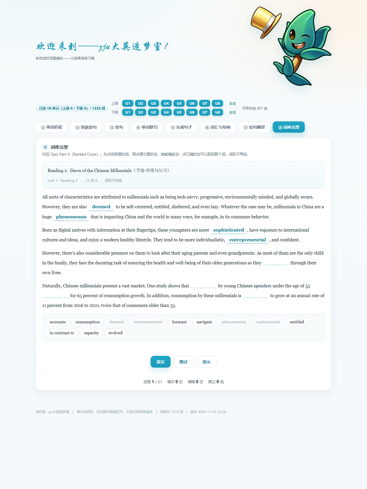
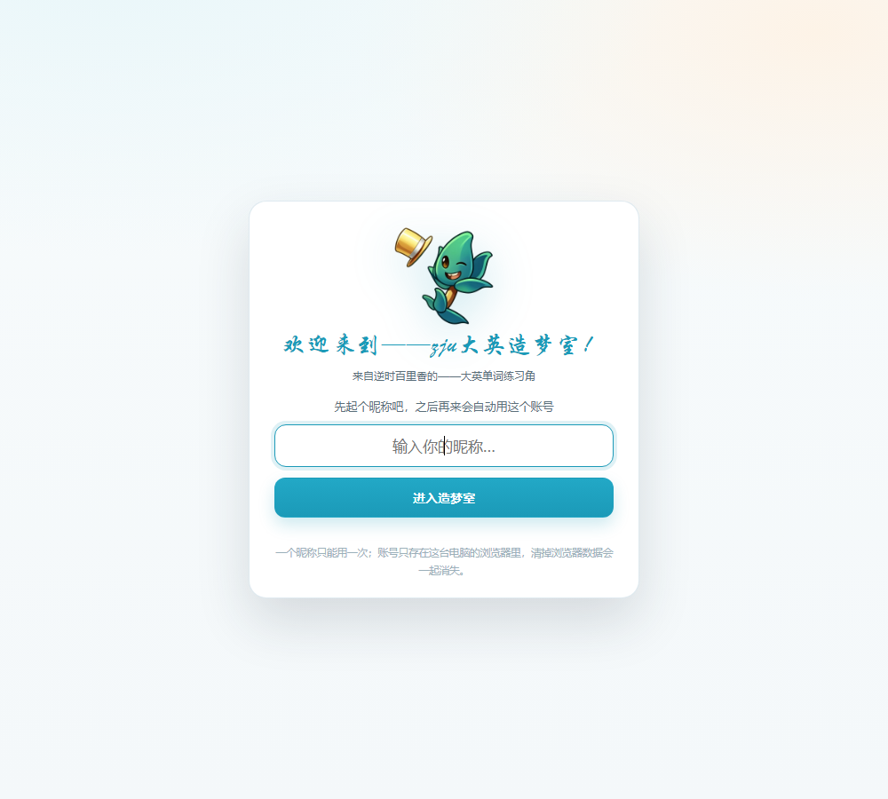

# 大英造梦室 · 单词练习场

一个**单文件**的大学英语单词练习网页，外加一个**零依赖**的 Node 小后端。
既能双击离线自练，也能架起来给一个班用：昵称全局唯一、单词本跨设备、凭 ID 认领。

> 教材：《新编大学英语（第四版）综合教程 2》　·　适合课前预习、课后巩固、考前突击



---

## 有什么

| 模块 | 玩法 | 对着什么练 |
|---|---|---|
| ① 单词匹配 | 左英右中，配对消除 | 词形 ↔ 释义再认 |
| ② 奇葩造句 | 每三个词一句荒诞句 | 语境记忆 |
| ③ 造句 | 每三个词一句正经句 | 用法 |
| ④ 单词默写 | 看中文写英文 | 产出拼写 |
| ⑤ 完成句子 | 挖空 + 首字母 + 中文 | 句子填空 |
| ⑥ 词汇与结构 | 四选一 + 解析 | 单选 |
| ⑦ 短句翻译 | 中译英 + 参考译文 + 采分点 | 翻译 |
| ⑧ 词库完型 | 15 选 10 | 完形填空 |
| ⑨ 个人主页 | 昵称 / ID / 单词本 / 重温 | — |
| ⑩ 听写 | 听 New Words 音频写单词，提交看答案+音标+释义 | 听音辨词 |

- 词库 1223 词，覆盖上下册各 8 个单元，可按单元勾选筛题
- 每个练习都有**提交 / 跳过 / 提示**三键，答对答错实时统计
- 单词本：默写时一键「加入」，主页「重温」可按打乱顺序再过一遍
- 全部题目内嵌在单个 HTML 里，**不发任何网络请求**，断网可用

---

## 快速开始

### 玩法一：自己练（不需要账号）

双击 `index.html` 就行。数据只存在浏览器本地。

### 玩法二：给一个班用

需要 [Node.js](https://nodejs.org/)（LTS 版）：

```bash
node _server/server.js
```

然后打开 <http://127.0.0.1:8787/>。或者直接双击 `启动后端.bat`。

启动后终端会打印本机的局域网地址，同一 WiFi 的同学用那个就能进。

### 玩法三：还要让校外的人用

下载 [cloudflared](https://developers.cloudflare.com/cloudflare-one/connections/connect-networks/downloads/)（或双击 `下载cloudflared.bat` 自动下），
然后双击 `启动公网隧道.bat`，会给你一个 `https://xxx.trycloudflare.com` 的公网地址。

校园网和公网**两条路可以同时开**，访问的是同一个服务、同一份数据。

---

## 三种模式怎么切换

`index.html` 启动时探一下 `/api/ping`：

| 打开方式 | 模式 | 能力 |
|---|---|---|
| `http://…` 或 `https://…` | 服务器模式 | 昵称全局唯一、单词本在服务器、可凭 ID 认领 |
| 双击 `index.html`（`file://`） | 本地模式 | 全功能，但账号只在这台浏览器 |
| 服务器挂了 | 自动降级 | 退回本地模式，不白屏 |

主页那行小字会写「服务器同步中」还是「本地模式」。

---

## 听写（⑩）

Book II Unit 1–4 的 New Words 音频已被切成「一词一段」，页面用 `<audio>` 按时间戳播放单个词。

- 音频文件**不在仓库里**（版权 + 体积），需要自己放进项目根目录，文件名保持原样：
  `Unit 1-Reading 1-New words.mp3`、`Unit 3-Reding 1-New Words.wav` 等
- 放好后页面会自动按文件名加载；缺文件时模块会提示「音频没加载到」
- 每组的词与时间戳是预先对齐写死在页面里的，换音频文件需要重新对齐

## 账号系统

- 只输**昵称**，系统分配 `ZJU-XXXXX` 的 ID
- 昵称在服务器上**全局唯一**，重名弹窗拒绝
- 之后再来自动登录（token 存在浏览器里）
- **凭 ID 认领**：换电脑 / 换浏览器 / 清了缓存，输入 ID 就能拿回昵称和单词本
  - 不区分大小写，`jvmna` 自动补成 `ZJU-JVMNA`
  - 认领不会踢掉原设备，手机电脑可同时用
  - ID 就是钥匙，页面会提醒学生别外传



---

## 目录

```
.
├── index.html              # 整个练习场（单文件，含题库与全部样式脚本）
├── _server/
│   ├── server.js           # 零依赖后端：静态托管 + 注册/认领/单词本 API
│   ├── README.md           # 部署与接口细节
│   └── data/db.json        # 运行时数据（首次启动自动生成，已 gitignore）
├── 启动后端.bat            # 校园网：起服务并打开浏览器
├── 启动公网隧道.bat        # 公网：起服务 + cloudflared 隧道
├── 下载cloudflared.bat     # 一键下载隧道工具
└── docs/                   # 截图
```

---

## 接口速查

| 方法 | 路径 | 说明 |
|---|---|---|
| GET | `/api/ping` | 健康检查，前端用它判断有没有后端 |
| POST | `/api/register` | `{nick}` → `{id, nick, token}`；重名 `409` |
| POST | `/api/claim` | `{id}` → 账号；无此 ID `404` |
| GET | `/api/me` | 需 `Authorization: Bearer <token>` |
| GET / PUT | `/api/book` | 单词本读写 |

详细部署（云服务器 / Render / 反代 / 备份）见 [`_server/README.md`](_server/README.md)。

---

## 上传到 GitHub

仓库已经初始化好（`main` 分支、首次提交已就位），只差推上去：

1. 在 GitHub 建好仓库（**Private** 即可，学生用的是网址不是仓库）
2. 双击 **`上传到GitHub.bat`**
3. 把仓库页 `Code → HTTPS` 里的地址粘进去，回车
4. 第一次会弹浏览器，点 **Authorize** 授权，等它跑完

也可以手动：

```bash
git remote add origin https://github.com/<用户名>/<仓库名>.git
git push -u origin main
```

> 仓库里只包含网页、后端、脚本和文档；音频、课件、抓取缓存、学生数据（db.json）都已被 `.gitignore` 挡掉。

---

## 版权与使用范围

- **代码**：MIT，见 [LICENSE](LICENSE)。
- **语言素材**：词表、课文句子、题目改编自《新编大学英语（第四版）综合教程 2》（浙江大学编著，外语教学与研究出版社）。
  版权归原编者与出版社所有，本仓库**仅供课堂教学与个人学习使用**，请勿用于商业用途或大规模转载。
  要公开分享，建议把 `index.html` 里的题库替换成自己编写的内容。

---

## 致谢

逆时草 · zju 大英造梦室　·　原站设计与制作：骆蓉 Luo Rong　·　练习场扩展与后端：本仓库贡献者
